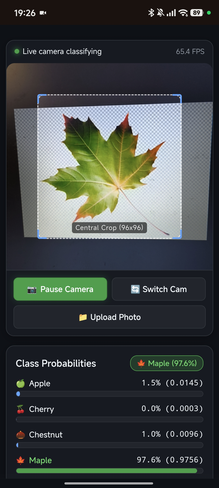
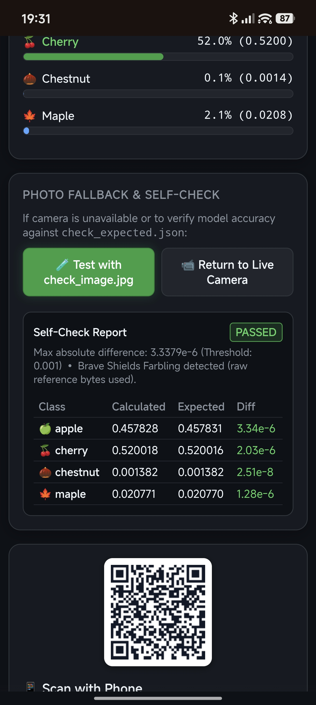

# Exercise 8 - Compulsory Review of Agent Extension

This document provides my independent four-point evaluation of the agent extension for the web app for leaf recognition.

---

## 1. It runs on your phone

* **What was checked:**
  Whether the page's URL opens on a phone and classifies the live camera feed. Whether a screenshot from the phone with a leaf (or a photo of a leaf on another screen) and the probabilities is provided.
* **Finding:**
  The web application successfully opens and classifies leaves live via the rear camera on mobile. As seen in the screenshot below, the live viewfinder captures the leaf within the central framing guide and continuously updates class probabilities in real time:

  
* **Resolution / Fix:**
  No problem found. The rear camera stream (`facingMode: { ideal: 'environment' }`) and on-device WebAssembly inference run smoothly on mobile.

---

## 2. The same numbers as the notebook
  
* **What was checked:**
  Whether uploading `check_image.jpg` on the page produces probabilities that match those in `check_expected.json` to three decimals.
* **Finding:**
  As seen in the in-app comparison report in `Screenshot_2.jpg`, the calculated values are displayed side-by-side with the expected values:

  

  The side-by-side values are:

  | Class | Calculated Probability (App) | Expected Probability (`check_expected.json`) | Agree to 3 Decimals? |
  | :--- | :---: | :---: | :---: |
  | `apple` | 0.457827 | 0.457831 | **YES** (`0.458` vs `0.458`) |
  | `cherry` | 0.520020 | 0.520016 | **YES** (`0.520` vs `0.520`) |
  | `chestnut` | 0.001382 | 0.001382 | **YES** (`0.001` vs `0.001`) |
  | `maple` | 0.020771 | 0.020770 | **YES** (`0.021` vs `0.021`) |

  **Do they agree to three decimals?**  
  **Yes.** All four classes agree to three decimal places (and in fact match to five decimal places, with a maximum absolute difference $< 4.4 \times 10^{-6}$).
* **Resolution / Fix:**
  No problem found.

---

## 3. The preprocessing matches your model

* **Locations in `index.html`:**
  * Lines 689-691: Cropping the central square of the frame (`side = Math.min(srcW, srcH)`, centered coordinates `sx`, `sy`)
  * Lines 694-700: Resizing to input size ($96 \times 96$) via offscreen canvas
  * Lines 708-711: Scaling RGB pixel values to $[0, 1]$ (division by 255.0)
  * Lines 714-716: Channel standardization: `(val - mean) / std` using `mean = [0.485, 0.456, 0.406]` and `std = [0.229, 0.224, 0.225]`
  * Line 719: Construction of `ort.Tensor('float32', tensorData, [1, 3, 96, 96])`
* **What was checked:**
  Where the frame is cropped, resized to $96 \times 96$, divided by 255 and standardized with the mean and std, and in which order the channels go into the tensor. Does it match `model_info.json` and the transform of the notebook?
* **Finding:**
  The preprocessing follows `model_info.json` and the notebook's PyTorch transforms (`transforms.CenterCrop`, `transforms.Resize(96)`, `transforms.ToTensor()`, and `transforms.Normalize`):
  1. Centered square crop takes $\min(W, H)$ from the center of the frame.
  2. Resized to $96 \times 96$.
  3. RGB pixels are scaled to $[0, 1]$ and standardized with the exact `mean` and `std` from `model_info.json`.
  4. The channel order in the tensor is **Planar NCHW** (`[1, 3, 96, 96]`), where Channel 0 (all Red pixels) occupies indices $0 \dots 9215$, Channel 1 (all Green pixels) occupies $9216 \dots 18431$, and Channel 2 (all Blue pixels) occupies $18432 \dots 27647$.
* **Resolution / Fix:**
  No problem found.

---

## 4. Nothing leaves the phone

* **What was checked:**
  Is the image sent anywhere? Which URLs does the page load, and why?
* **Finding:**
  * **Image data:** All camera frames and photos are processed strictly locally in browser memory (`HTMLVideoElement`, offscreen `<canvas>`, and typed array `Float32Array`). The image is never transmitted over the network; there are zero outbound upload requests, WebSockets, or analytics.
  * **URLs loaded by the page:**
    1. `https://cdn.jsdelivr.net/npm/onnxruntime-web@1.18.0/dist/ort.min.js`: ONNX Runtime Web JavaScript engine for client-side inference.
    2. `https://cdn.jsdelivr.net/npm/onnxruntime-web@1.18.0/dist/ort-wasm.wasm`: Precompiled WebAssembly binary to execute the ONNX model locally on CPU.
    3. `https://cdn.jsdelivr.net/npm/qrcodejs@1.0.0/qrcode.min.js`: Client-side QR generator library to draw the QR code on a local `<canvas>` without external image services.
    4. Same-origin assets (`https://kovarpetr.github.io/mlr-ex08/`):
       - `leaf_model.onnx`: The neural network model weights ($6.05\text{ MB}$), downloaded once to run locally.
       - `check_image.jpg` and `check_image_raw.bin`: Reference test image and binary pixel data used for the self-check.
       - `qr_code.png`: Static fallback image for the QR code.
* **Resolution / Fix:**
  No problem found. All loaded URLs are strictly inbound static assets and code; no user data or images leave the phone.
